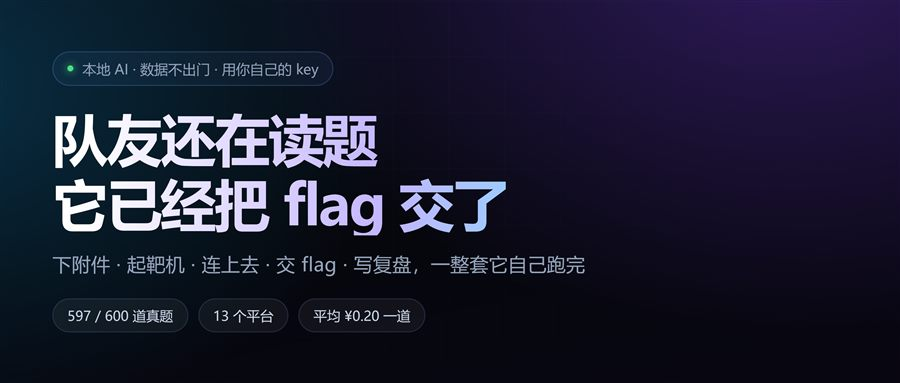
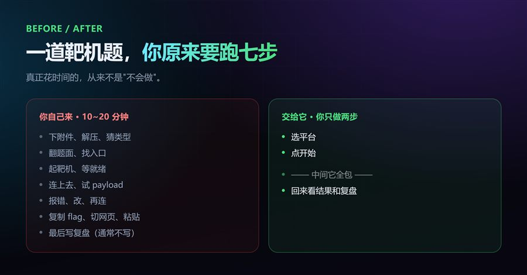
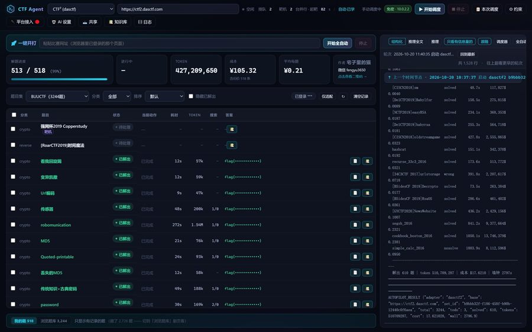
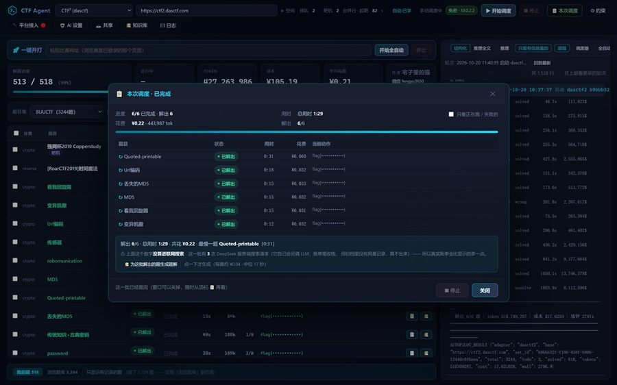
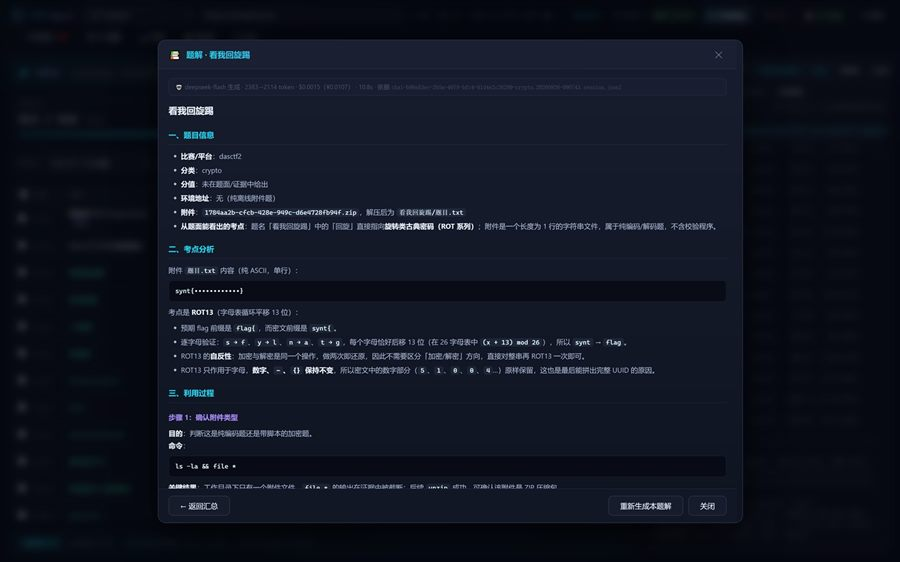
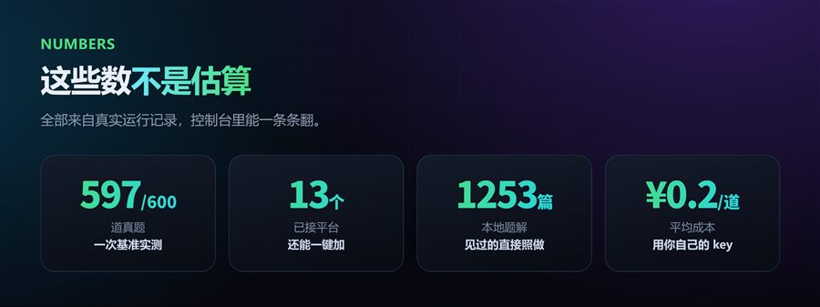
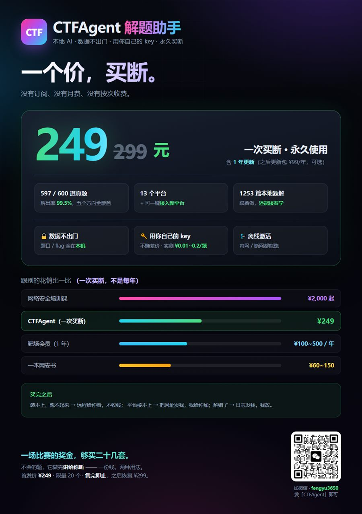

# CTF Agent 解题助手

**能自己打 CTF 的智能体 —— 起靶机、跑 exp、交 flag，一整套它自己跑完**

本地 AI · 数据不出门 · 用你自己的 key

---

一场 CTF 四小时，真正"不会做"的时间不多。

大头是跑腿：下附件、解压、起靶机、等就绪、连上去、试 payload、报错、改、再连、复制 flag、切网页、粘贴。一道题十几二十分钟就没了。

---

## 它做什么

装好之后双击图标，选平台，点开始。剩下的它自己来：拉题、下附件、起靶机、写脚本、连上去、跑、提交。

界面上能看到每一行都是真实跑过的：题名、状态、当前动作、耗时、花了多少 token、多少钱。

---

## 一次真实的一轮

前几天跑的一批，6 道 crypto：**1 分 29 秒，¥0.22，全解出。**

最慢的一道 31 秒，六分钱。

这钱不是给作者的 —— 你用的是你自己的 DeepSeek key，按 token 计费，不赚差价。

按这个价，一块钱能跑二十道。

---

## 跑完它还会写复盘

题干怎么读、考点在哪、每一步跑了什么命令、输出是什么，都写在生成的复盘里。

见过的题本地知识库直接有，没见过的它自己算。

---

## 几个数，都是跑出来的

- **597 / 600** 道真题（一次基准实测，剩三道真卡住）
- **13 个平台**：Bugku、CTFHub、NSSCTF、攻防世界、CTFshow、DASCTF、看雪 KCTF、i春秋……
- **1253 篇本地题解**
- **平均 ¥0.20 一道**

新平台也能接：贴一个网址，它自己去摸接口和签名。

---

## 三个不妥协

**数据不出门。** 题目、附件、flag 全在你电脑里，只连比赛平台和你自己的 API。

**用你自己的 key。** 账单在 DeepSeek 后台，不在作者手里。

**离线激活。** 授权就两个文件，断网也能跑。

---

## 说点它做不好的

部分平台的题目分类和附件解析还在补；靶机题的续期刚上线，长题目偶尔会撞平台限流；硬题会烧预算，到线就停。

碰到问题把日志发过来，改完免费推给你。

---

## 怎么拿

**首发价 ¥249**（原价 ¥299），一次买断，含一年更新。

**限量 20 个，售完即止。**

加微信 **fengyu3650**，发一句「安装包」。

官网：http://1.13.191.154/

---

它不会让你变成高手。

但那些跑腿活它替你干了。一场比赛省下来的两三个小时，才是真正用来想题的时间。

---

> 本仓库只放介绍与截图，产品本体不开源。
